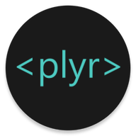
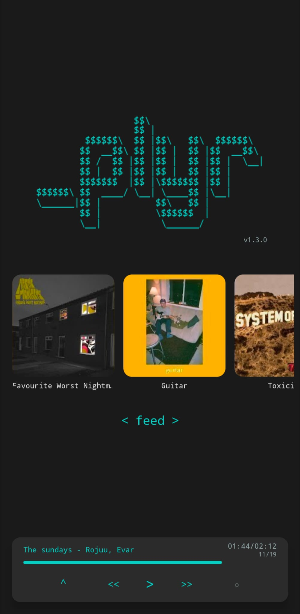
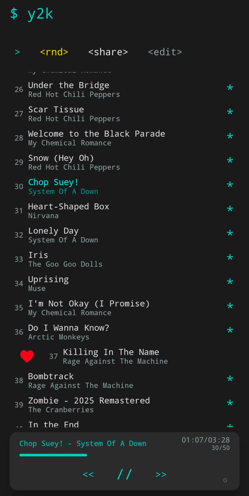
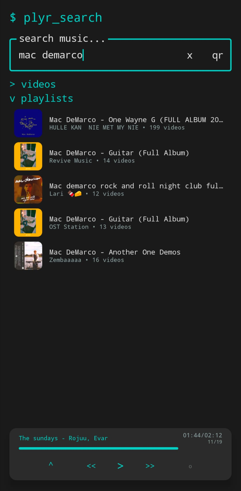
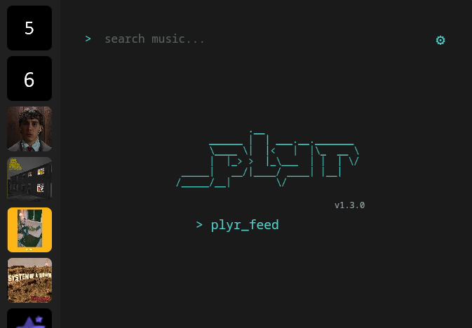
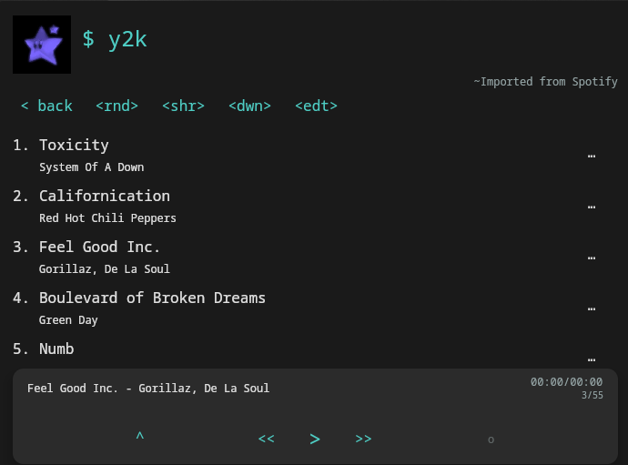
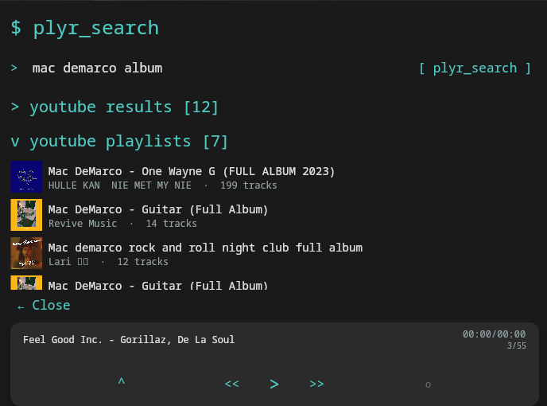

**A minimalist, terminal-inspired music player**

Stream any song, build playlists, share them with a QR code, sync across devices. Terminal-inspired, runs on Android, Windows, Linux and macOS. Open source, no ads, no telemetry. Features: YouTube streaming, local playlists, offline downloads, QR share, cross-device sync, desktop integration.

## android

  
  
  

## desktop

  
  
  

## roadmap

- [ ] **Web port** — browser client (proposal in `okf/proposals/web-port.md`).
- [ ] **Android Auto** — descriptor, library and playback implemented; pending device validation.
- [ ] **Architecture** — `PlayerViewModel` orchestration and `MusicService` owning the player (partially done).
- [ ] **Tests** — run instrumented tests on a device: QrCode, DataImporter.
- [x] **Build hygiene** — compiler warnings removed, Gradle/AGP/Kotlin migrated.

## license

**_plyr** is Free Software: You can use, study, share, and improve it at will. Specifically you can redistribute and/or modify it under the terms of the [GNU General Public License](https://www.gnu.org/licenses/gpl-3.0.en.html) as published by the Free Software Foundation, either version 3 of the License, or (at your option) any later version.

This project uses:

- [NewPipeExtractor](https://github.com/TeamNewPipe/NewPipeExtractor), originally created by [Team NewPipe](https://github.com/TeamNewPipe), licensed under GPL-3.0.
- [ExoPlayer / Media3](https://developer.android.com/media/media3), [Room](https://developer.android.com/jetpack/androidx/releases/room), [Compose](https://developer.android.com/jetpack/compose), [OkHttp](https://square.github.io/okhttp/), [Coil](https://coil-kt.github.io/coil/) and [CameraX](https://developer.android.com/training/camerax), each under their respective licenses.

---

  <b>Made with ♫ by <a href="https://github.com/josemri">josemri</a></b>

