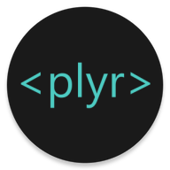
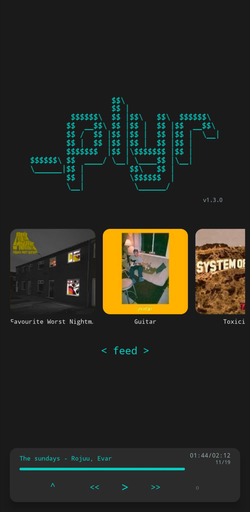
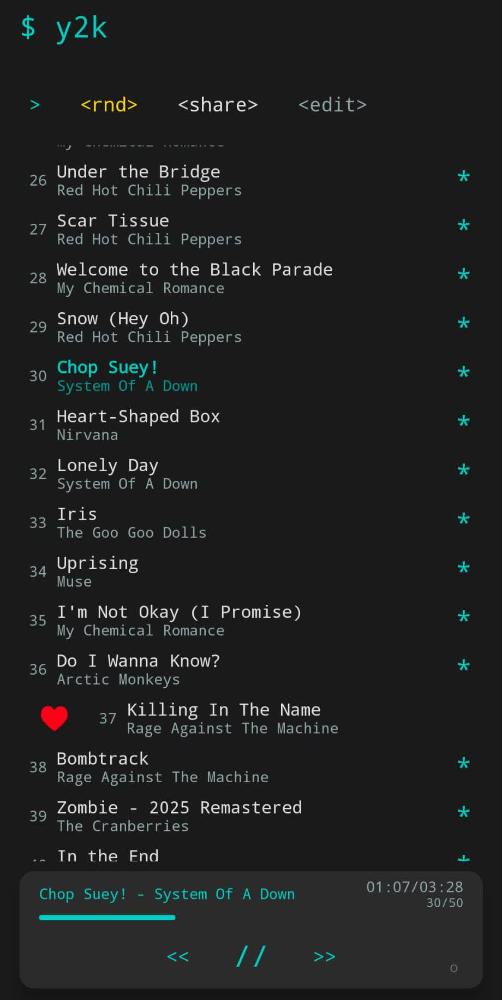
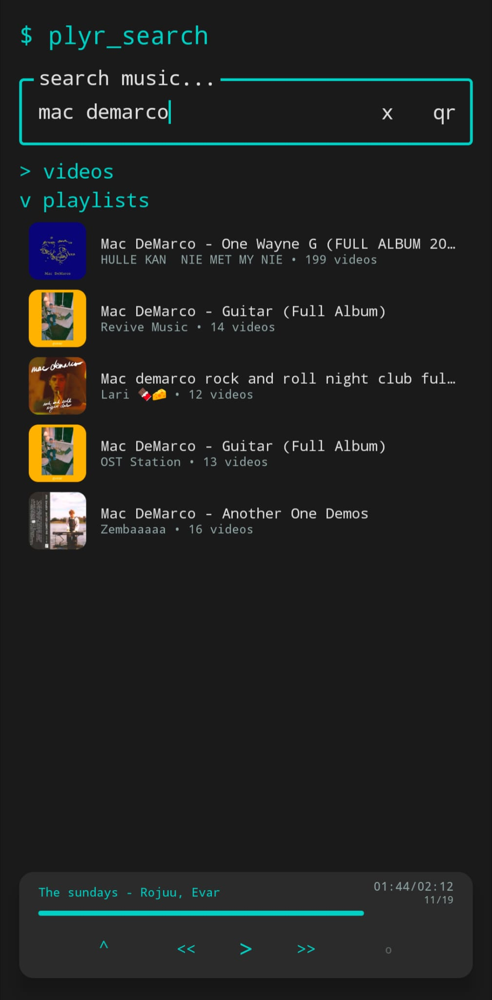
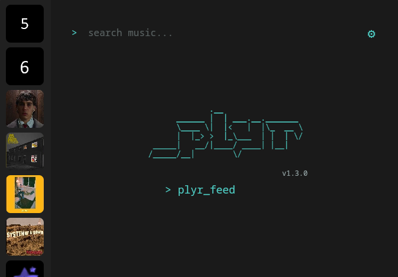
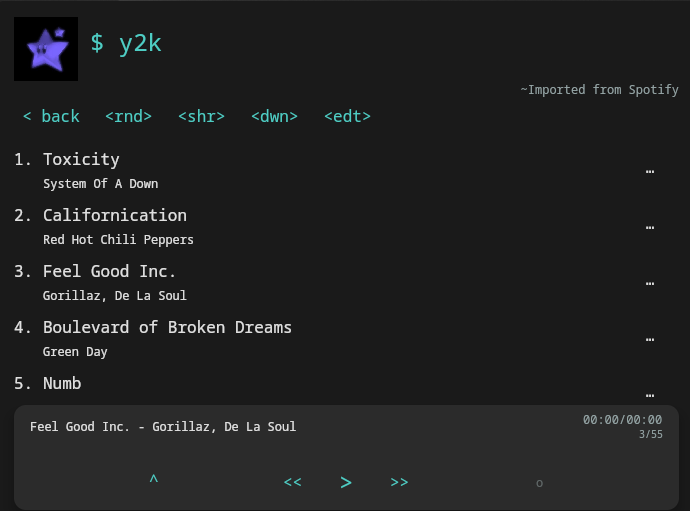
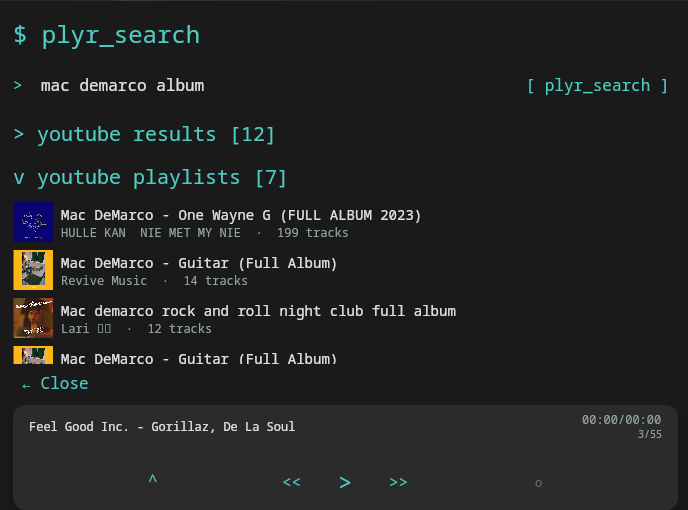

**A minimalist, terminal-inspired music player**

[](https://www.gnu.org/licenses/gpl-3.0)
[](https://www.android.com)
[](https://github.com/josemri/plyr/releases)
[](https://kotlinlang.org)


stram any song, build playlists, share 'em with qr, sync across devices. terminal inspired, runs on android, windows, linux and macOS. Open source, no ads, no telemetry.

## features

- **YouTube streaming** — search and play any song (NewPipe Extractor).
- **Local playlists** — create, edit and reorder playlists; import a playlist from a **Spotify URL**
- **Scan & share** — share a playing track/playlist as QR or NFC tag; scan to open it.
- **Backup** — pick a folder once and a `plyr-sync.zip` inside it keeps itself up to date on its own .
- **Multiplatform** — compiled for android, windows, linux(debian && arch based) and macOS.
- **run.sh** — bash script to compile, test, check all project.
- **Recommendations feed** — community playlist recommendations synchronized via Supabase. 

## android

<div align="center">
  
  
  
</div>

## desktop

<div align="center">
  
  
  
</div>

## android permissions

```xml
NFC                       # Tag scanning / sharing of playlists
INTERNET                  # Stream music and fetch metadata
FOREGROUND_SERVICE        # Background playback
FOREGROUND_SERVICE_MEDIA_PLAYBACK
POST_NOTIFICATIONS        # Playback controls
CAMERA                    # QR code scanning (optional hardware)
```

## roadmap

- [ ] **Android Auto** — support for the Android Auto interface
  - [ ] Declare `automotive_app_desc.xml` and the automotive permissions
  - [ ] Expose the library (playlists, queue) through the Media3 `MediaSession`
  - [ ] Playback screen and controls in the head unit
- [ ] **Architecture** — untangle UI, network, DB and business logic
  - [ ] Cover `PlayerViewModel` orchestration (deferred: Robolectric, or extract a pure orchestrator with injected dependencies)
  - [x] Split `PlaylistScreen.kt` into a `PlaylistViewModel` + Compose state
  - [x] Split `SearchScreen.kt` into a `SearchViewModel` + Compose state
  - [x] Split `ConfigScreen.kt` into a `ConfigViewModel` + Compose state
  - [ ] Make `MusicService` own the player instead of projecting onto the `PlayerViewModel`'s `ExoPlayer` (deferred: device-only-verifiable lifecycle change; `MusicService` is rewritten for desktop anyway)
- [ ] **Tests**
  - [ ] Run the instrumented tests on a device (`./run.sh test device`): NfcReader, QrCode, DataImporter
- [ ] **Search Carrusel** reimplemente carrusel for album results
- [ ] **Queue back** add back button to queue in desktop
- [ ] **Home button** add home button for desktop version
- [ ] **Playlist carrusel** carrusel will allways be visible in desktop

## license

[](https://www.gnu.org/licenses/gpl-3.0.en.html)

**_plyr** is Free Software: You can use, study, share, and improve it at will. Specifically you can redistribute and/or modify it under the terms of the [GNU General Public License](https://www.gnu.org/licenses/gpl-3.0.en.html) as published by the Free Software Foundation, either version 3 of the License, or (at your option) any later version.

This project uses:

- [NewPipeExtractor](https://github.com/TeamNewPipe/NewPipeExtractor), originally created by [Team NewPipe](https://github.com/TeamNewPipe), licensed under GPL-3.0.
- [ExoPlayer / Media3](https://developer.android.com/media/media3), [Room](https://developer.android.com/jetpack/androidx/releases/room), [Compose](https://developer.android.com/jetpack/compose), [OkHttp](https://square.github.io/okhttp/), [Coil](https://coil-kt.github.io/coil/) and [CameraX](https://developer.android.com/training/camerax), each under their respective licenses.

---

<div align="center">
  <b>Made with ♫ by <a href="https://github.com/josemri">josemri</a></b>
</div>
